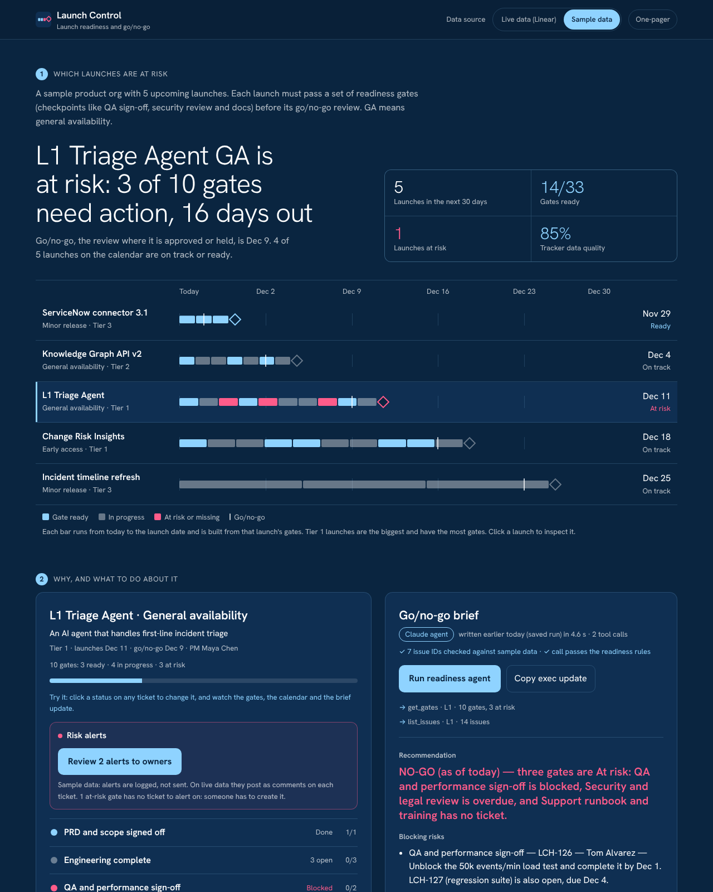

# Launch Control

**Is every launch ready? One screen answers it, and an AI agent writes the go/no-go brief from live tracker data.**



## The problem

Before a tier 1 launch, someone in product ops spends hours chasing status across R&D, QA, docs, enablement, support and marketing to answer one question: *are we ready?* The answer lives in a tracker, but it's scattered, half the tickets are missing owners or dates, and the gaps that hurt most are the ones nobody filed. The go/no-go meeting runs on stale, hand-assembled status.

Launch Control reads the tracker, scores every launch against its readiness gates, finds the gaps (including gates with no ticket at all), writes the brief, and fixes the tracker hygiene that would otherwise make the report wrong.

## What it does

| | |
| --- | --- |
| **Launch calendar** | Every launch as a bar from today to its date, built from its gate segments: ready, in progress, at risk. The headline is the finding ("L1 Triage Agent GA is at risk: 3 of 10 gates need action, 16 days out"). |
| **Readiness gates** | Tier 1 launches have 10 gates, Tier 2 have 7, Tier 3 have 3. A gate is **at risk** if it has no ticket, or any open ticket is blocked, overdue, or due after go/no-go (launch − 2 days). **Ready** when every ticket is done. |
| **Readiness agent** | Claude (`claude-sonnet-5-5`) with three read-only tools (`list_launches`, `get_gates`, `list_issues`), streamed live with a tool trace. Fixed format: Recommendation · Blocking risks · Before go/no-go · Exec update. ~6 s per brief. |
| **Brief checks** | Every AI brief is checked against the data it was written from: each cited issue ID must exist, and the go/no-go call must match the rules engine. Shown under the brief with the run time and tool calls. |
| **Risk alerts** | For each at-risk gate, one message per blocked, overdue or due-after-go/no-go ticket, to its owner (or the team lead / PM if unowned). Review and tick, then send: posted as a comment on the ticket in Linear (the owner is notified), logged only on demo data. The same ticket isn't alerted twice in 24 h. |
| **Go/no-go decision** | A person records Go, Go with conditions or No-go under the brief. It's previewed, then posted to the launch's Linear project as a status update with a health flag, the readiness numbers at that moment and the exec update. Overriding the rules is allowed and is on the record. |
| **Rules-engine brief** | Same format with no AI: the default view and the automatic fallback, so the review never stalls. |
| **Tracker data quality** | Flags open tickets with no owner, no due date, no update in 14+ days, or no launch. Demo: auto-fix. Linear: review the proposed fixes, then apply the ticked ones. |
| **Manual work removed** | A log of what was automated and an estimate of minutes saved (45 min per readiness sweep, 3 min per ticket fix). |
| **Live or sample data** | One switch. Demo data is the default so the app always works. |

## How it works

```
Browser (Next.js client)                    Server (Next.js route handlers)
─────────────────────────                   ───────────────────────────────────────────────
calendar · gates · brief · hygiene  ──GET──▶ /api/tracker   → TrackerSource: demo | Linear (5 s timeout)
                                    ──POST─▶ /api/brief     → Claude tool-use loop, ≤6 tool turns, SSE
                                    ──POST─▶ /api/hygiene/apply → recompute fixes, write confirmed ones to Linear
                lib/readiness: pure functions shared by all of the above
```

- **`lib/readiness/`**: pure, unit-tested functions: `gateInfo`, `launchInfo`, `hygieneChecks`, `proposeFixes`, `rulesBrief`, `boardSummary`. Dates are ISO calendar dates and "today" is an input, so scoring is timezone-free.
- **`lib/tracker/`**: a `TrackerSource` interface with two adapters. `demo.ts` is the sample org with dates relative to today. `linear.ts` reads a Linear team. `linear-schema.ts` holds the whole Launch Control ↔ Linear mapping (PRD §5), shared by the seed script and the adapter.
- **`lib/agent/`**: the agent's tools and prompt. **`app/api/brief`** runs the loop server-side and streams `tool`, `text`, `done` and `error` events.
- **`components/`**: the UI, ported from the approved prototype (`prototype/index.html`).

### How we know the agent is right

`npm run eval` runs the same agent loop as the app on two scenarios (fresh demo data, and "a week later" with five tickets changed so four launches are at risk for different reasons), 3 runs per launch, and checks every brief against its data. Latest run ([docs/EVAL.md](docs/EVAL.md)):

| Metric | Result |
| --- | --- |
| Briefs whose go/no-go call passed the readiness-rules check | **30/30** |
| Invented issue IDs | **0** of 157 cited |
| At-risk tickets cited | **21/21** |
| Blocking risks limited to at-risk gates | 30/30 |
| Exact 4-section format | 30/30 |
| Latency p50 / p95 | 4.6 s / 5.6 s (target < 30 s) |
| Cost per brief | ~$0.013 |

The rules make the go/no-go call and act as the guardrail on the agent. The agent adds what rules can't: who has to do what by when, the things the rules don't score (an unowned ticket in a healthy gate), and an update a VP can read in ten seconds.

### Safety and resilience
- **Secrets stay on the server.** The browser only learns *whether* Claude and Linear are configured.
- **Untrusted text is rendered as text.** Claude output and Linear titles go through a small Markdown parser into React text nodes; there's no `innerHTML` anywhere.
- **Every external call has a timeout and a visible fallback.** Linear (5 s) falls back to demo data with a banner. Claude (45 s), or a missing key, rate limit or refusal, falls back to the rules brief, and the trace says why.
- **Cost and write guards.** A passcode (`DEMO_PASSCODE`) gates Claude runs and Linear writes, plus a per-IP rate limit (10 agent runs per hour).
- **The agent never writes, and nothing is sent on its own.** Tracker changes and risk alerts only happen after a person reviews and confirms; the server recomputes the fixes or alerts itself and acts only on confirmed ones that are still valid.

## Run it locally

Needs Node.js 20+.

```bash
cd launch-control
npm install
cp .env.example .env.local    # add keys; with none, the app runs on demo data + rules brief
npm run dev                   # http://localhost:3000
```

| Variable | Purpose |
| --- | --- |
| `ANTHROPIC_API_KEY` | Claude for the readiness agent |
| `LINEAR_API_KEY`, `LINEAR_TEAM_KEY` | Live mode (team key, e.g. `LCH`) |
| `DEMO_PASSCODE` | Required for agent runs and Linear writes when set; leave empty locally |

### Tests and checks

```bash
npm test                                   # Vitest: gate rules, hygiene, briefs, agent tools, Linear mapping, guards
npm run build                              # production build + type check
npm run check:linear                       # live Linear readiness vs. demo, launch by launch
npm run smoke -- <url> --passcode <p>      # walks the demo script in a real browser (see below)
npm run eval -- --runs 3                   # agent eval, 30 briefs, writes docs/EVAL.md (~$0.40)
npm run demo:video -- http://localhost:3000   # re-record the captioned walkthrough (see scripts/record-demo.ts)
```

`npm run smoke` needs a browser once per machine: `npx playwright install chromium`. Add `--no-agent` to skip the paid Claude call. It never writes to Linear.

### Linear setup

```bash
npm run seed:linear                        # dry run: what would be created in the team
npm run seed:linear -- --yes               # states, labels, 5 launch projects, 41 issues (skips what exists)
npm run seed:linear -- --restore --yes     # morning of a demo: re-date launches to today, undo fixes and status changes
npm run seed:linear -- --restore --clear-comments   # list (add --yes to delete) comments the app posted: alerts, nudges
npm run seed:build                         # dry run of the build's own "Launch Control v1" project
npm run seed:build -- --dogfood --yes      # put the build itself on the calendar (Tier 3, launches on the interview day)
```

A launch is a team project with a `Tier 1/2/3` project label and a target date that hasn't passed. Gates are issue labels in the `Gate` group. Sample-org people aren't workspace members, so owners and PMs are stored as `Owner:` and `PM:` lines; a real assignee always wins.

## Deploy (Vercel)

Import the repo, set **Root Directory** to `launch-control`, and add the four environment variables. Set `DEMO_PASSCODE` before sharing the URL. Then run the smoke test against the production URL.

## Project docs

[Walkthrough video](public/demo.mp4) · [PRD](PRD.md) · [Agent eval](docs/EVAL.md) · [Hard questions](docs/HARD_QUESTIONS.md) · [Decisions log](DECISIONS.md) · [Backlog](BACKLOG.md) · [Talk track](docs/TALK_TRACK.md) · [Approved prototype](prototype/index.html)

<!-- Deployed on Vercel from this branch (Root Directory: launch-control). -->
